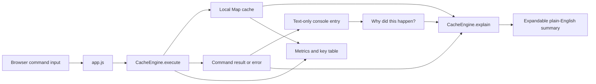
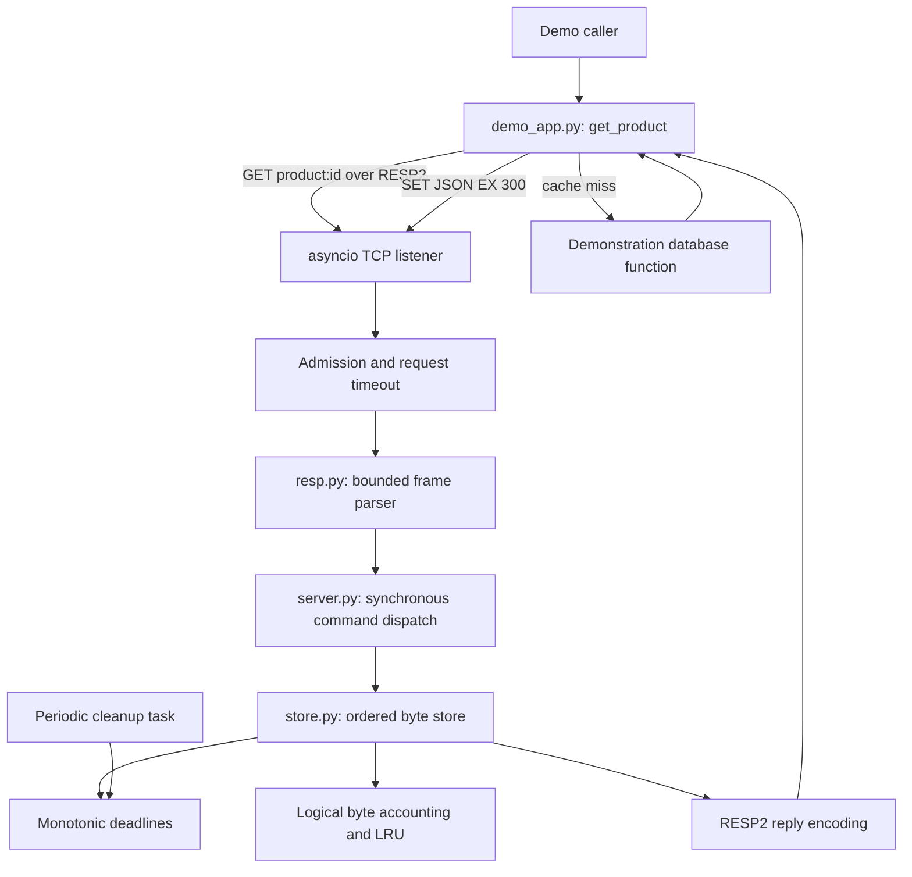
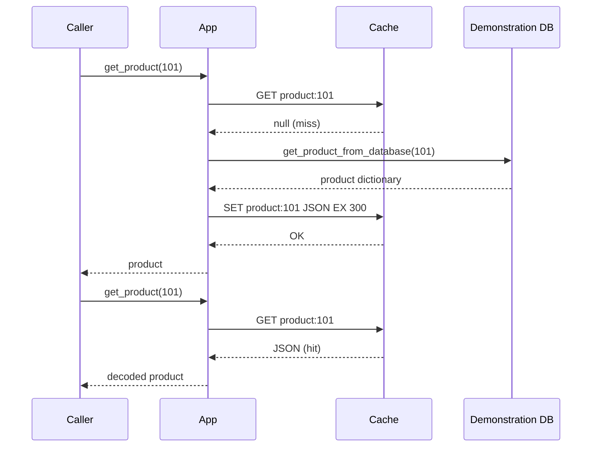

# Ember and the educational RESP2 cache

## 1. Scope and outcome

### Browser experience: Ember

The primary visual entry point is [index.html](index.html), styled by
[styles.css](styles.css), with browser interactions in [app.js](app.js) and an
independently testable cache and command tutor in [cache.js](cache.js). Open the
HTML directly: no framework, build, external fonts, CDN, backend or installation
is required. Ember uses original branding and a restrained red/neutral palette.

The browser playground is a **standalone local simulation**, not an HTTP API or
a connection to the Python RESP2 server described below. Browsers cannot directly
speak raw TCP RESP2. No bridge is implemented; a future real-server dashboard
would need a deliberately scoped HTTP/WebSocket bridge with origin checks and
access controls.

The browser command path is:

```text
form / quick command / key-delete action
  -> app.js run()
  -> CacheEngine.execute() synchronously mutates the local Map
  -> result and CacheEngine.explain() summary are logged with textContent
  -> the learner can expand "Why did this happen?"
  -> metrics and key table are rendered from the current engine state
```

Every command submitted through the console, quick-command buttons or key-table
delete action has an inline **"Why did this happen?"** button, including errors.
Activating it reveals a plain-English explanation for the command outcome.
`CacheEngine.explain()` uses the command text, result, failure flag and local
cache state where needed; it is a small deterministic command-aware tutor, not
an LLM. It makes no network requests, sends no cache contents outside the tab,
and requires no API key, model, backend or extra dependency. It does not execute
commands or change cache state. Its summaries are teaching aids for this
browser subset, not Redis-generated diagnostics or a substitute for the
command's actual response.

The browser cache uses a synchronous `Map`, lazy expiration based on
`performance.now()`, and a one-second visual refresh. GET and successful SET
update LRU ordering. Limits are 50 keys, 1,024 UTF-8 bytes per key, 4,096
UTF-8 bytes per value and 8,192 characters per command. These intentionally
differ from the Python server. Browser commands are SET (EX/NX/XX), GET, DEL,
EXISTS, TTL, EXPIRE, PERSIST, KEYS * (browser only), DBSIZE, FLUSHDB, PING and
HELP. Hit rate counts GET commands only, not table refreshes; displayed payload
size counts UTF-8 key/value bytes, not browser heap usage. There is no
persistence or network access. Refresh clears state; Reset restores four sample
keys and clears stats. Values and explanations are assigned with `textContent`,
not interpolated as HTML.

Responsive layouts stack the terminal and key explorer on narrow screens.
Semantic landmarks, visible focus, labeled controls, live command-result
announcements, keyboard command history, expandable tutor controls, mobile
navigation and reduced-motion support address accessibility and interaction
across input modes.

Run `node --test tests\web.test.cjs` for dependency-free cache-engine tests,
including command tutor explanations. The frontend test suite does not require
or call an AI service. The Actions web job checks JavaScript syntax and runs the
engine suite.

This project also includes an **educational Redis-like server from scratch**,
not the Redis database itself. The original Python product demo is its client.
The server implements a deliberately small RESP2-compatible string cache; it is
independent of the browser simulation.

The requested workflow is: **planning agent -> architecture -> implementation
from the plan -> executable acceptance tests -> reusable GitHub agents and CI**.
AI assists engineering; it is not part of the server request path.

### Included

- Standalone browser cache playground with local command explanations.
- Python standard-library TCP server using asyncio.
- Binary-safe string keys/values and a documented Redis command subset.
- Cache-aside product example using the real redis-py client.
- Monotonic TTL, lazy and periodic expiration, logical memory limits, LRU eviction.
- Bounded request parsing, read/write deadlines and admitted-client limits.
- Unit, socket, concurrency, real-client and demo subprocess tests.
- Native Windows usage, non-root Docker image, local-only Compose publication.
- Repository-scoped Copilot planning/build/review agents and GitHub Actions.

### Not included

Persistence (RDB/AOF), replication, Sentinel, cluster sharding, transactions,
Lua, pub/sub, streams, hashes/lists/sets, RESP3, authentication, authorization,
TLS, exact Redis error messages, Redis performance, or production suitability.
No claim of full Redis compatibility is made. All data disappears on restart.
Use real Redis or a managed service for production, not this server.

## 2. System architecture

The browser and server are separate execution paths. The browser has no
networking layer; the Python demo is the only component that connects to the
RESP2 TCP listener.





### Components and dependencies

| Component | Responsibility | Dependencies |
|---|---|---|
| [index.html](index.html) | Browser playground structure and accessible controls | HTML |
| [styles.css](styles.css) | Responsive browser presentation and tutor styling | CSS |
| [app.js](app.js) | Browser event handling, result log, tutor toggle, metrics and table | cache.js, browser DOM |
| [cache.js](cache.js) | Local command parser, Map cache, TTL/LRU behavior and deterministic explanations | Browser APIs |
| [tests/web.test.cjs](tests/web.test.cjs) | Browser cache and tutor engine tests | Node.js built-ins |
| [demo_app.py](demo_app.py) | Product lookup, JSON serialization, cache-aside | redis-py, json, os |
| [resp.py](resp.py) | Bounded request decoding and RESP2 reply encoding | asyncio |
| [store.py](store.py) | Byte values, TTL, LRU and byte accounting | collections, time |
| [server.py](server.py) | Command validation, dispatch, transport lifecycle, CLI | resp, store, stdlib |
| [tests/test_core.py](tests/test_core.py) | Parser, store and command acceptance tests | unittest |
| [tests/test_integration.py](tests/test_integration.py) | Real sockets, client and original demo | unittest, redis-py |

Dependency direction for the Python service is
`demo -> TCP -> server -> resp/store`. The browser path is
`index.html -> app.js -> cache.js`; it does not depend on the Python server.
Neither the Python store nor protocol codec imports redis-py. The server needs
no pip packages. The client dependency is pinned in [requirements-dev.txt](requirements-dev.txt).

## 3. Cache-aside behavior



- Keys use `product:{id}`; values are UTF-8 JSON.
- Cache lifetime is 300 seconds, bounded by eviction and process lifetime.
- The database function returns illustrative data, not a persistent database.
- Two calls per ID produce one miss then one hit. IDs 101 and 102 are separate.
- The demo intentionally preserves fail-fast behavior: connection, JSON and
  write failures propagate rather than masquerading as successful cache hits.
- No distributed request coalescing exists: concurrent misses can duplicate DB
  work. Individual cache commands are atomic, not the GET/DB/SET sequence.
- A future database update should commit to the source of truth then invalidate
  the key with DEL. This is a recommended extension, not an implemented write
  API; TTL alone permits stale data and does not resolve update/read races.
- Negative caching, TTL jitter, circuit breakers, stale-while-revalidate and
  single-flight locks are future options, not features of this demo.

## 4. Protocol and command contract

Only RESP2 arrays of non-null bulk strings are accepted as requests.
Command and option names are case-insensitive ASCII byte comparisons.
Keys and values remain bytes; no server-side UTF-8 decoding is required.
Responses use simple strings, bulk strings, integers, null bulk strings or errors.

Example:

```text
Request bytes:  *2\r\n$3\r\nGET\r\n$11\r\nproduct:101\r\n
Missing reply: $-1\r\n
PING reply:    +PONG\r\n
Error reply:   -ERR explanation\r\n
```

| Command | Behavior |
|---|---|
| `PING [message]` | PONG, or bulk-string message |
| `ECHO message` | Binary-safe bulk-string echo |
| `GET key` | Value or null bulk string |
| `SET key value [EX seconds \| PX milliseconds] [NX \| XX]` | OK on write, null if condition fails |
| `DEL key [key ...]` | Number of live keys deleted; duplicates do not inflate count |
| `EXISTS key [key ...]` | Number found; duplicate existing arguments count individually |
| `TTL key`, `PTTL key` | Floored remaining seconds/milliseconds; -1 persistent, -2 missing |
| `EXPIRE key seconds`, `PEXPIRE key milliseconds` | 1 if live key updated; 0 missing; non-positive deletes immediately |
| `PERSIST key` | 1 if expiration removed, otherwise 0 |
| `DBSIZE` | Live key count after expiration sweep |
| `FLUSHDB` | Clear the single database |
| `SELECT 0` | OK; all other database numbers rejected |
| `CLIENT SETINFO LIB-NAME value` | Accepted metadata no-op |
| `CLIENT SETINFO LIB-VER value` | Accepted metadata no-op |

SET validates every option before mutation. NX and XX are mutually exclusive.
EX and PX are mutually exclusive; duplicates, missing values and unknown options
are errors. SET expiration must be positive. Plain successful SET clears a
previous TTL. Failed conditional SET does not evict other entries.
Integer inputs are bounded to signed 64-bit, including conversion to milliseconds.
TTL rounding is explicitly simplified and need not match Redis at boundaries.

Unknown commands, unsupported options and invalid arity return `-ERR`.
An ordinary command error leaves the connection usable; an unrecoverable framing
error returns an error and closes it. EOF/truncated disconnects close the
connection without executing a partial command. Payloads are not logged.

### Client compatibility

The demo explicitly selects `protocol=2` and sets five-second connection/socket
timeouts. redis-py connection metadata is accepted through CLIENT SETINFO.
No password, RESP3 HELLO negotiation, nonzero database, or custom client-name
handshake is supported. Use `pipeline(transaction=False)` for pipelining;
the redis-py default transactional pipeline sends unsupported MULTI/EXEC.

## 5. Storage, expiration and memory

- One `OrderedDict[bytes, bytes]` is the store and LRU ordering.
- GET hits and successful SET operations make a key most recently used.
  EXISTS, TTL, EXPIRE and failed conditional writes do not refresh recency.
- A second ordered dictionary maps expiring keys to monotonic deadlines.
  Removing, replacing, persisting or flushing a key also updates this index.
- Lazy expiration occurs before reads, existence checks and TTL operations.
- Every second a single janitor task visits up to 128 expiration records,
  rotating unexpired records so all deadlines eventually receive a visit.
  Under load, expired entries can stay allocated until visited, but are never
  served as live values.
- A successful SET sweeps all expiration records before evicting live LRU keys.
  DBSIZE also sweeps all deadlines to provide an exact live count.
- Logical cost is `len(key) + len(value) + 64` per item. Replacements subtract
  the old cost; deletion/expiration/flush restore accounting.
- An item larger than the configured budget is rejected without replacing the
  old value. Otherwise, least-recently-used entries are evicted until it fits.

The logical limit **is not a process RSS guarantee**. Python dictionaries,
expiry metadata, allocator overhead, socket buffers, replies and in-flight
requests use additional memory. Full expiration sweeps on writes/DBSIZE are
O(number of expiring keys); this favors clarity over production latency.
Periodic cleanup is bounded; foreground sweeps deliberately are not.

## 6. Concurrency, limits and failure handling

Each connection has an asyncio task. Parsing and draining await network I/O;
dispatch and all store mutations contain no awaits. Consequently a single
command is atomic on the event loop. There are no threads mutating the store,
multi-command transactions, durability guarantees or cross-process coordination.

| Limit | Default |
|---|---|
| Bind | `127.0.0.1:6379` |
| Logical dataset budget | 16 MiB, configurable with `--max-bytes` |
| Key / value maximum | 1,024 bytes / 1 MiB |
| Bulk string maximum | 1 MiB |
| Arguments per command, including command name | 128 |
| Full encoded request budget | 2 MiB + 4,096 bytes |
| Request header line | 128 bytes including CRLF |
| Admitted clients | 100, configurable with `--max-clients` |
| Complete request read / reply drain deadline | 30 seconds each, `--timeout` |
| Periodic expiration sweep | At most 128 deadlines per second |

Lengths and request totals are validated before reading the declared payload.
Oversized keys are rejected by SET; framing limits apply to all commands.
The request deadline covers the entire request, not just idle gaps, so a client
cannot keep an incomplete command alive forever by sending occasional bytes.
Writer drain provides backpressure and has a deadline.
Max-clients limits admitted connections, not the OS accept backlog or a strict
whole-process memory bound. Many simultaneous rejected connections still cost
temporary resources; this is not an Internet-facing DoS-resistant service.

Shutdown stops accepting, cancels cleanup, closes connections, cancels/awaits
their tasks, then waits for the listener to close. Ordering matters: waiting
for listener closure before disconnecting clients can delay Python 3.13 shutdown.
Expected network failures are debug-logged without data; unexpected exceptions
remain visible through asyncio logging. Startup/bind errors propagate.

## 7. AI tools and responsibility boundaries

Use the relevant available tool, not every AI product on every task.
Model brands are optional choices; the project does not depend on them.

The browser's "Why did this happen?" feature is **not an AI service**. It is
implemented in `CacheEngine.explain()` as local, deterministic teaching text
selected from the command, response, error status and relevant in-memory state.
The browser does not submit commands, responses or cache state to an LLM or
remote service. The explanation is supplemental and does not affect command
execution. Changes to tutor wording or command coverage belong in the browser
engine and its tests, not in the Python server or AI-tool configuration.

| Tool or role | Intended engineering use | Required at runtime? |
|---|---|---|
| GitHub Copilot / VS Code assistant | Inspect workspace, implement approved plan, explain diffs | No |
| Planning agent | Read-only architecture, scope, risks, acceptance tests | No |
| Build agent | Implement approved scope and execute tests | No |
| Review agent | Read-only correctness and regression findings | No |
| MCP | Tool access protocol for editor/GitHub integrations, subject to permissions | No |
| Pylance | Interpreter facts, Python syntax, types, references and diagnostics | No |
| unittest / terminal tools | Deterministic acceptance evidence; not themselves AI | No |
| GitHub Actions | Repeat tests on pushed branches/PRs; not an AI agent | No |
| GitHub Copilot cloud coding agent | Optional issue-to-PR implementation in a connected repository | No |
| ChatGPT / Claude / Gemini | Optional approved design critique or test brainstorming | No |

No runtime LLM calls, API keys, vector databases, embeddings, RAG stack or
AI-generated cache decisions are used by either application. Do not send private
source, logs, credentials or customer data to external tools. Evaluate optional
models only under the repository owner's data-sharing policy; validate
suggestions with tests. GitHub access must be explicitly authorized and limited
to the intended repo.

## 8. Planning-agent demonstration and implementation plan

A read-only planning subagent was actually invoked before implementation.
It received the original demo behavior, the confirmed from-scratch scope and the
requested AI/GitHub workflow. Its deliverable was a plan, not modified files.
The following captures its approved plan and how it was executed.

### Planning-agent input template

> Plan a standard-library asyncio RESP2 cache server compatible with this
> redis-py cache-aside demo. Include TTL, bounded parser/memory, LRU, connection
> lifecycle, real-client acceptance tests, local-only Docker, Copilot agents
> and CI. Explicitly exclude persistence, authentication and production claims.
> Do not edit files. Return ordered phases, invariants, risks and tests.

### Ordered plan and acceptance gates

| Phase | Prerequisite | Implementation | Acceptance gate |
|---|---|---|---|
| 1: Protocol and store | Scope confirmed | RESP2 codec, byte store, monotonic TTL, LRU/accounting | Binary, malformed/oversized frames, fake-clock expiration and eviction tests |
| 2: Commands and server | Phase 1 | Validate commands, atomic dispatch, client limits, timeouts, lifecycle | Command shapes, invalid-option non-mutation, sockets and isolation |
| 3: Existing demo | Phase 2 | Explicit RESP2, pinned redis-py, environment host/port | Live client handshake and original demo: two misses, two hits |
| 4: Reproducible delivery | Architecture agreed | Architecture, agents, Docker/Compose and CI | Full suite, syntax checks, container and health-check smoke test |

Implementation intentionally combines command dispatch, CLI and configuration
in server.py rather than adding separate commands.py/config.py modules. The
small command set did not justify those extra layers. The protocol and store
remain independently testable. This is a structural simplification, not a scope
reduction.

### Reusable workspace/GitHub agent definitions

- [Cache Plan](.github/agents/plan.agent.md): read/search only; output plan and stop.
- [Cache Build](.github/agents/build.agent.md): read/search/edit/execute; implement
  approved plan, run tests, report evidence and stop.
- [Cache Review](.github/agents/review.agent.md): read/search only; report
  actionable correctness findings and test gaps without editing.
- [Project instructions](.github/copilot-instructions.md): shared invariants.

These are repository-scoped definitions. Select the corresponding agent in
VS Code, subject to extension support, and pass the previous stage's output.
The sequence is an explicit human-approved handoff, not a hidden automatic loop.
Tool aliases and agent discovery depend on the host's supported custom-agent
schema; verify available agents/tools in that host before relying on restrictions.

Suggested build input:

> Follow ARCHITECTURE.md and the approved Cache Plan. Implement phases 1-3,
> preserve the documented limits, add acceptance tests, and report exact results.
> Do not publish, push, or add runtime AI dependencies.

Suggested review input:

> Review the implementation against ARCHITECTURE.md and the approved plan.
> Focus on reproducible protocol, TTL, eviction, lifecycle and compatibility
> regressions. Return file/line evidence and missing tests; do not edit.

### Optional GitHub cloud-agent workflow

1. A human creates/chooses a GitHub repository and reviews what may be published.
2. Push this project only after approval. No repository was created or pushed
   during this local build.
3. Ensure Copilot coding agent/custom-agent support is enabled for that repository
   and account. Availability and controls depend on GitHub settings.
4. Open an issue with one bounded phase, architecture link, non-goals and exact
   acceptance tests. Ask the planning agent for a plan and approve it.
5. Assign/delegate the approved issue to Copilot using the supported GitHub UI,
   selecting the build agent if that interface supports repository custom agents.
6. Require a PR, passing Actions tests and human diff review. Use Cache Review
   where supported, or manually apply its review checklist.
7. Merge only after approval; rollback code by reverting the PR. Cache contents
   cannot be restored because the implementation is deliberately volatile.

The local planning subagent ran in this session. The reusable named agents,
GitHub cloud workflow and Actions matrix are delivered configurations; creating
their files is not evidence that GitHub has executed them.

## 9. Native Windows setup and demonstration

Targeted CI versions are Python 3.11-3.13. Use Python 3.13 locally if available.
From the project directory in PowerShell:

```powershell
python -m venv .venv
.\.venv\Scripts\python.exe -m pip install -r requirements-dev.txt
.\.venv\Scripts\python.exe -m unittest discover -s tests -v
.\.venv\Scripts\python.exe server.py
```

In a second terminal:

```powershell
$env:REDIS_HOST = "127.0.0.1"
$env:REDIS_PORT = "6379"
.\.venv\Scripts\python.exe demo_app.py
```

Expected on a fresh server: miss/hit for 101, then miss/hit for 102, each followed
by its product dictionary. Repeating before expiry may produce only hits.
Ctrl+C stops the server. No service is left running by the test suite.
The demo retains its original environment defaults: localhost and port 6379.

To avoid a port conflict and demonstrate tighter limits:

```powershell
.\.venv\Scripts\python.exe server.py --port 6380 --max-bytes 1048576 --max-clients 20 --timeout 10
```

Set REDIS_PORT to 6380 in the client terminal for that example. Limits must be
positive; port zero is allowed for automatically assigned test ports.

## 10. Container architecture

[Dockerfile](Dockerfile) packages only the stdlib server with a non-root user.
[compose.yaml](compose.yaml) drops capabilities, uses a read-only filesystem,
and verifies a RESP2 PING/PONG health check.

```powershell
docker compose config --quiet
docker compose up --build -d
docker compose ps
.\.venv\Scripts\python.exe demo_app.py
docker compose down
```

Do not run native and Compose servers on port 6379 simultaneously.
The process binds 0.0.0.0 **inside the container**; Compose publishes
`127.0.0.1:6379:6379` **on the host**. These are different layers.
Other containers on the same network may still reach the service.
There is no volume or durable data. Stopping/recreating loses all contents.
The Python base-image minor tag is not an immutable supply-chain pin; use a
reviewed digest and image scanning if extending the packaging policy.

## 11. Validation and operational checklist

The full command is:

```powershell
.\.venv\Scripts\python.exe -m unittest discover -s tests -v
node --test tests\web.test.cjs
```

| Area | Measurable acceptance evidence |
|---|---|
| Browser cache and tutor | Command explanations, cache outcome summaries and browser-cache behavior pass the Node.js engine suite; no remote service required |
| Protocol | Binary payloads, split reads, pipelining; malformed, truncated and oversized frames rejected |
| Store | Deterministic fake-clock TTL/PERSIST/replacement; bounded janitor rotation |
| Memory | Exact logical accounting, LRU victim, expired-first cleanup, oversized-write preservation |
| Commands | Reply types; NX/XX and EX/PX; malformed options do not mutate old value |
| Connections | Concurrent clients, timeout, max-clients, isolated framing errors, clean shutdown |
| Real client | redis-py RESP2 handshake, GET/SET EX 300, TTL, nontransaction pipeline |
| Original demo | Actual subprocess exits zero and prints exactly two misses and two hits |
| Delivery | Compose config, Docker build, runtime PING/PONG, demo against container |

The first local pass exposed a Python 3.13 listener/client shutdown-order bug.
Shutdown was corrected and its test now checks closed connections and no tracked
client tasks. Tests use ephemeral loopback ports and clean up their own resources.

### Previously verified implementation and delivery results

- Windows, Python 3.13.14, isolated venv, pinned redis-py 5.2.1:
  **22 tests passed**.
- The browser engine suite now has **6 passing tests**, including deterministic
  tutor explanation checks. During the tutor-mode change, all 22 Python
  regression tests also passed.
- The same 22 tests also passed with the pre-existing redis-py 8.1.0 environment;
  that observation is not a guarantee of compatibility with all client versions.
- Pylance syntax checks passed for the protocol, store, server and both test files;
  workspace diagnostics returned no reported items.
- Docker image built successfully; the server ran as user `cache`.
- An actual Compose-configured container reached Docker's **healthy** state on
  an ephemeral loopback-published port. The original demo then printed exactly
  two misses and two hits against that container.
- The Compose health probe was corrected to construct the RESP dollar marker
  without relying on Compose dollar-sign interpolation, then revalidated through
  the actual container health state rather than configuration parsing alone.
- Test containers and the dedicated Compose test network were stopped/removed.
  No server is deliberately left running.

The Actions workflow in [.github/workflows/tests.yml](.github/workflows/tests.yml)
installs the pinned client and runs tests on Windows and Ubuntu, Python
3.11/3.12/3.13. This matrix is configured, not a claim that remote CI already ran.
No benchmark or coverage percentage is claimed. Native Ctrl+C on every platform,
large-scale load and hostile-network deployment are not certified by these tests.

### Operating boundaries

Keep the server on a trusted local machine with disposable data. Loopback is not
authentication, especially on a shared host. Any reachable client can GET values,
evict data through writes or issue FLUSHDB. No secrets or personal data belong
here. Logs currently show startup and unexpected failures, not production
metrics. Observe test failures and process logs; do not turn failures into silent
success-shaped fallbacks.

### Future work, requiring a new approved plan

Real Redis comparison tests, property/fuzz tests, load/latency measurement,
metrics, incremental foreground expiration, source-of-truth update/invalidation,
and graceful signal handling across container orchestrators are possible next
steps. Persistence, authenticated transport, replication or new Redis data types
are separate architectural projects, not implied by this implementation.
